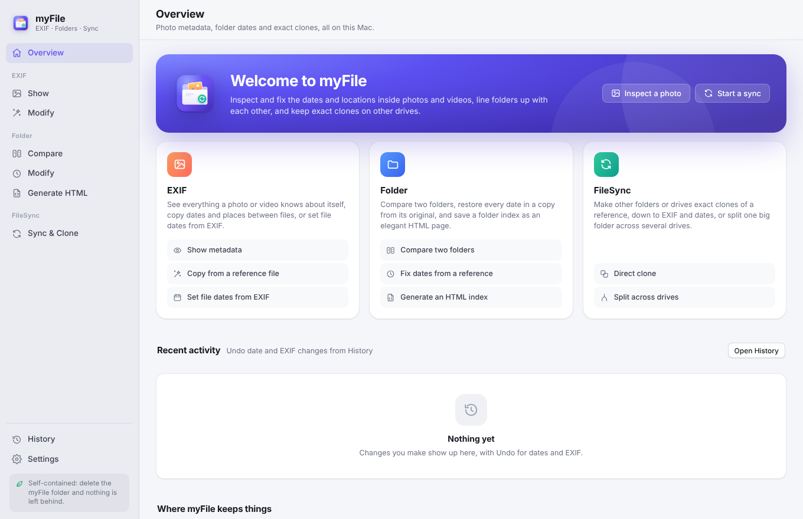
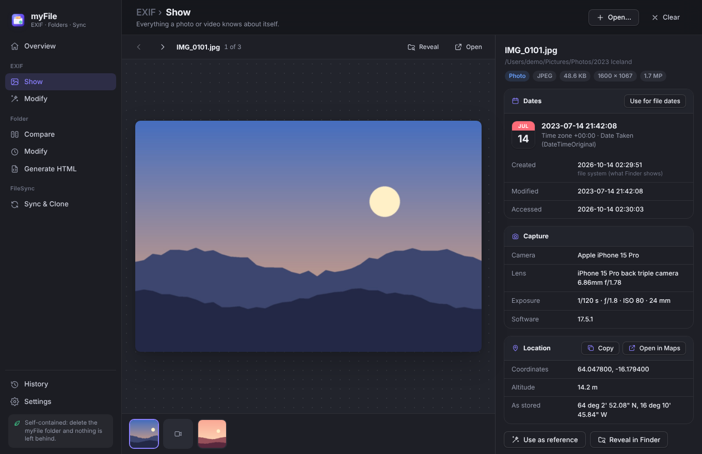
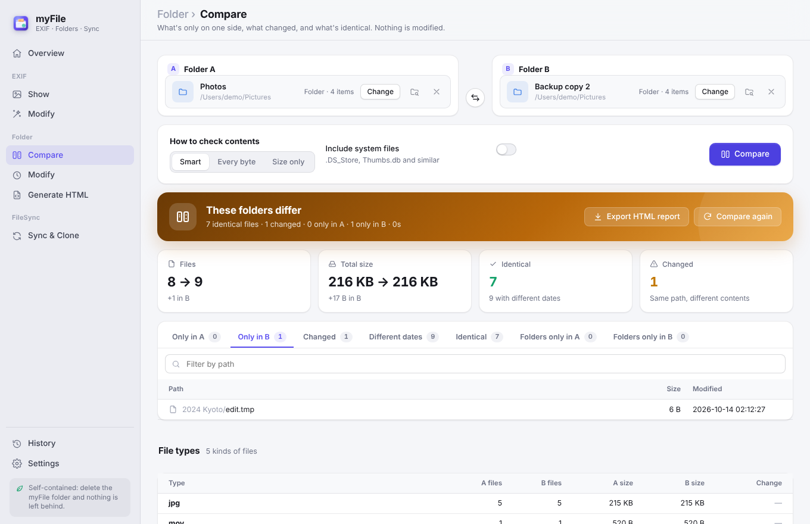
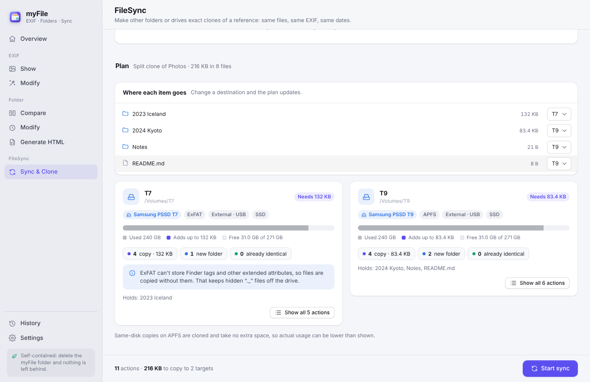
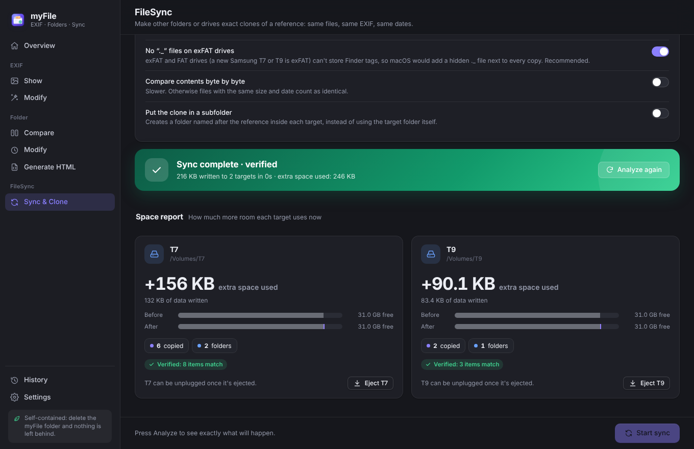

<p align="center">
  
</p>

<h1 align="center">myFile</h1>

<p align="center">
  Photo metadata, folder dates and exact clones, in one Mac app.<br>
  Built on your Mac from this folder. Delete the folder and it's all gone.
</p>



## What it does

### EXIF

- **Show**: drop photos or videos to see them on the left and everything about them on the right: date taken (with time zone), created and modified dates, camera, lens and exposure, GPS location (one click opens Apple Maps), and every metadata tag, grouped and searchable. HEIC, RAW, TIFF and other formats are previewed too.
- **Modify › Copy from a reference**: drop one reference file and any number of target files or folders. Their date and time (with sub-seconds and time zone), GPS location and, if you like, camera details are rewritten to match the reference. It works across types: a photo can be the reference for a video and the other way round. The file dates Finder shows can follow along.
- **Modify › Use each file's own date**: sets every file's created and modified dates to the date stored inside it.

You always see a table of *current → new* values before anything is written, and changes can be undone from History. The one exception is the advanced *Copy every metadata tag* option, which says so.



### Folder

- **Compare**: drop two folders to see what's only in A, only in B, changed, identical, and identical but with different dates, plus a breakdown by file type. Contents are compared byte by byte where it matters, or choose Smart, Every byte, Size only, or Custom, where Settings lets you tick exactly what must match (size, dates, EXIF dates, GPS, other metadata, contents) without reading every byte. Export the result as an HTML report.
- **Modify**: drop a reference (a folder, or an HTML index from Generate HTML) and one or more target folders. myFile first checks that each target has exactly the same names and nesting. Dates and EXIF aren't part of that check, because they're what gets fixed. Then it sets the created and modified dates of every file and folder, and the EXIF dates inside photos and videos, to the reference's values. Targets that don't match are never touched.
- **Generate HTML**: saves a folder's whole tree, with created, modified and EXIF dates, as one self-contained web page with search, sorting and the oldest/newest items. The page carries its data, so it works as a **reference for Folder › Modify**: you can restore the dates onto a copy of the folder later, even after the original is gone. HTML files made by the older `file_directory.py` script work as references too.



### FileSync

One reference folder, one or more targets. Each target becomes an **exact clone**: same files, same bytes (so the same EXIF), same created and modified dates.

- **Direct clone**: every target gets everything. With one target this is the only option.
- **Split clone**: the reference's top-level folders are shared out across the targets, each one kept whole, so together the targets hold one copy. Items already on a target stay there; you can move any item to another target from a drop-down.
- **Clone all** or **Choose items**: pick exactly which folders and files to include.
- Mirror mode (optional) removes what the reference doesn't have. Anything replaced or removed goes to the Trash, or is deleted if you choose.
- At the end, a **space report** shows how much extra room each drive now uses, with before and after bars, and every target is re-checked against the reference.



#### Made for external SSDs (Samsung T7, T9 and similar)

- **Knows the drive.** Each target shows its model, format (exFAT, APFS, Mac OS Extended, FAT32), connection and whether it's an SSD.
- **No `._` clutter.** A new T7 or T9 is formatted exFAT, which can't store Finder tags and other extended attributes. macOS would quietly add a hidden `._` file next to every copy, each taking a full disk block. myFile copies without them (you can turn this off).
- **Format limits handled up front.** Files over 4 GB on FAT32 drives are flagged before copying. Names that exFAT can't store (`? * : " < > |`) are pointed out, as are names that differ only in upper/lower case. NTFS drives, which macOS can read but not write, are refused with an explanation. Time comparisons respect each format's precision (10 ms on exFAT, 2 s on FAT32).
- **Unplug-safe.** Files are copied under a temporary name and only renamed when complete, and each file gets its date immediately. If the drive is pulled out, myFile stops with a clear message. The next run cleans up the half-copied file and carries on where it left off.
- **Fast on SSDs, gentle on hard disks.** Several files at a time on SSDs, one at a time on spinning disks. Copies within the same APFS disk are clones that take no extra space.
- **Your Mac stays awake** during a sync, and **Eject** buttons appear when it's done.
- **The drive's own system folders** (`.Spotlight-V100`, `.fseventsd`, `.Trashes` …) are never touched, even in mirror mode.



### History

Every change is listed in History. Date and EXIF changes from EXIF › Modify and Folder › Modify have an **Undo** button that puts the old values back.

## Install

You need a Mac with macOS 12 (Monterey) or newer, Apple silicon or Intel, and an internet connection for the first install. No Xcode, Homebrew or admin password.

1. Download this repository: **Code › Download ZIP** on GitHub, then double-click the ZIP. (Or `git clone` it.)
2. Open **Terminal**, type `bash ` (with a space), drag **install.sh** from the folder into the Terminal window, and press Return.

   Or, if you're already in the folder:

   ```sh
   bash install.sh
   ```

3. Wait a few minutes. The installer downloads Node.js (checksum-verified), Electron and ExifTool *into this folder*, builds **myFile.app** next to `install.sh`, and opens it.

From then on, open **myFile.app** from the folder like any app. You can drag it into the Dock. Keep the app in its folder: that's where it keeps its settings and history.

Why build on your Mac instead of downloading a ready-made app? macOS blocks apps downloaded from the internet unless they're notarized by Apple. An app built locally from these files is yours, so it opens normally. The installer also signs it (ad hoc, no Apple account involved), which Apple silicon Macs require.

The first time myFile opens a file on your Desktop, in Documents or Downloads, or on an external drive, macOS asks for permission. That's normal.

**Updating**: download the new version and run `bash install.sh` in it (or `git pull` and run it again). `bash install.sh --rebuild` only rebuilds the app from the current source.

## Nothing left behind

Everything myFile uses lives in its folder:

| What | Where |
| --- | --- |
| Node.js (only used to install and build) | `.runtime/node/` |
| Electron and ExifTool | `node_modules/` |
| The app | `myFile.app` |
| Settings, history, previews, Chromium's data | `.runtime/appdata/` |

The installer points npm's cache, Electron's download cache and temporary files into `.runtime/` too, and removes the downloads when it finishes. It installs nothing system-wide and touches nothing in your home folder.

macOS itself keeps a few notes about every app you run: window-restore state, a preferences file the open/save panels write, and some caches in `~/Library`. **myFile removes these each time it quits.** So deleting the folder is enough to remove myFile completely.

For a guaranteed clean removal, including the privacy permissions you granted and macOS's app registry entry, run:

```sh
bash uninstall.sh                 # clean up macOS's records, then delete the folder
bash uninstall.sh --keep-source   # same, but keep the source to rebuild later
```

The folder takes about 500 MB after installing (Electron is most of it). The app inside it is an APFS clone of the Electron runtime, so it uses no extra disk space.

## Good to know

- **Time zones.** A photo's date without a time zone means local time on this Mac, as ExifTool reads it. QuickTime videos store UTC; myFile shows and writes them in the right zone, and fills in Apple's `Keys:CreationDate`, which Photos uses.
- **Creation dates** (Finder's "Created") are set through macOS's own Foundation framework, so Apple's developer tools (`SetFile`) aren't needed.
- **Precision.** By default dates within one second of each other count as the same, which is what Finder shows. Settings › Comparing switches to exact matching, or two seconds for FAT32 drives. New dates are always written exactly.
- **System files** such as `.DS_Store`, `._*` and `Thumbs.db` are ignored everywhere unless you turn on *Include system files*.
- **EXIF edits keep the file's identity**: myFile writes inside the existing file, so Finder tags, comments and the creation date survive.

## For developers

```sh
bash install.sh --no-open   # set up Node, Electron and ExifTool in the folder
bash scripts/dev.sh         # run from source (DevTools available)
bash scripts/dev.sh --test  # run the test suite
```

- `src/main/`: Electron main process. `handlers.js` lists every operation; `features/` holds EXIF, Folder and FileSync; `lib/` holds ExifTool (persistent `-stay_open` processes), file dates, scanning, drive detection and copying.
- `src/renderer/`: the interface (plain JavaScript, no build step).
- `scripts/build-app.mjs`: assembles `myFile.app` from the Electron runtime: renames the app and its helpers, edits `Info.plist`, adds the code, ExifTool and icon, and signs it ad hoc.
- `test/`: Node test suite (`node --test test/*.test.js`) with real ExifTool runs. `test/harness/server.js` serves the real interface in a browser, wired to the real backend, for UI work without Electron.

## Credits

[ExifTool](https://exiftool.org) by Phil Harvey reads and writes the metadata. [Electron](https://www.electronjs.org) runs the app.
